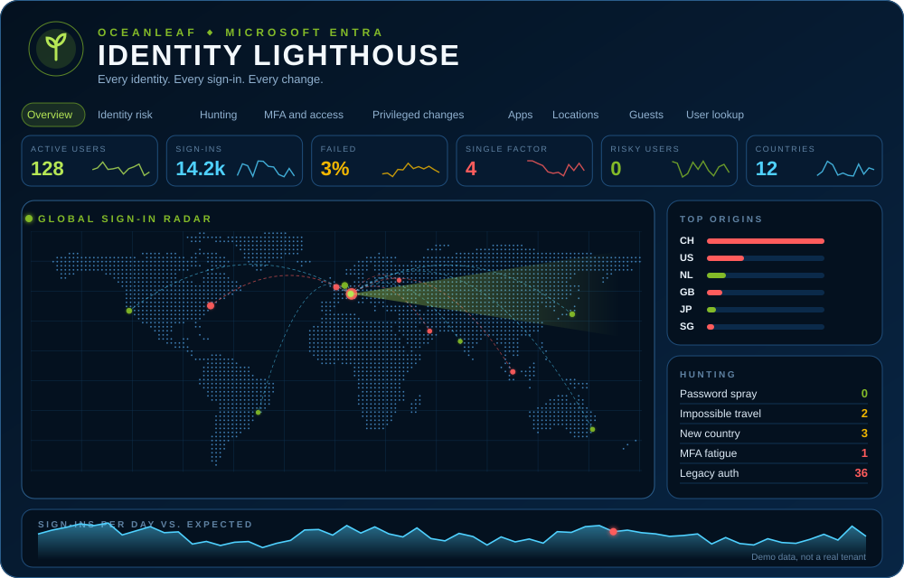

# Identity Lighthouse

A command center for Microsoft Entra: where sign-ins come from, who is at risk, what changed and which workload identities act without a person.

| | |
|---|---|
| Tables | `SigninLogs`, `AuditLogs`. Optional: `AADRiskyUsers`, `AADUserRiskEvents`, `AADServicePrincipalSignInLogs`, `AADManagedIdentitySignInLogs` |
| Roles | Log Analytics Reader, Workbook Contributor to save |

- **Sign-in radar:** world map with origins, failures in red, routes to your main origin
- **Pulse and posture:** heatmap by weekday and hour, rings for MFA coverage, Conditional Access and failure rate
- **Hunting:** password spray, brute force, impossible travel, new countries, MFA fatigue
- **Tabs:** Overview, Identity risk, Hunting, MFA and access, Privileged changes, Apps, Locations and devices, Guests, User lookup
- **Privacy mode:** users, IPs and tenants become pseudonyms. The preview shows demo data

Tabs without their optional tables show a query error, the rest keeps working. The workbook shows personal data, check your internal rules before you share access.

## Install

Use the button, pick the resource group of your workspace and paste its resource ID into *Workbook Source Id*. Or: Azure Monitor → Workbooks → New → Advanced Editor (`</>`), paste [`identity-lighthouse.workbook`](identity-lighthouse.workbook), apply and save.

Read-only, provided as is under the [MIT License](../../LICENSE).
