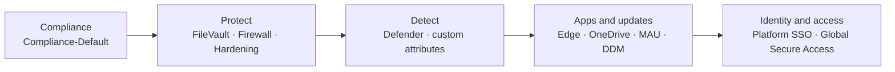

# Intune macOS Templates

A complete baseline for managed Macs in Microsoft Intune: 18 profiles that cover compliance, disk and firewall protection, Defender for Endpoint, Microsoft apps, updates, single sign-on and Global Secure Access. Import what you need, assign it to a test group first.

| | |
|---|---|
| Profiles | 18 (10 settings catalog, 4 device configuration, 3 custom attributes, 1 compliance) |
| Platform | macOS 14 and later |
| Assignments | none, nothing is assigned until you do it |
| Tenant data | none, IDs, timestamps and assignments are removed |

## What is inside

### Compliance

| Profile | What it does |
|---|---|
| `CompliancePolicies/Compliance-Default` | Password required (8 characters, no simple passwords, history of 3), macOS 14 or later, System Integrity Protection, disk encryption, Gatekeeper limited to the App Store and identified developers, firewall on |

### Protect

| Profile | What it does |
|---|---|
| `SettingsCatalog/EndpointSecurity-FileVault` | FileVault 2 with recovery key escrow |
| `SettingsCatalog/EndpointSecurity-Firewall` | macOS application firewall |
| `SettingsCatalog/SettingsCatalog-BasicSecurityHardening` | Restrictions such as password autofill and sharing, login window and screen settings. Inspired by [hmaslowski.com](https://hmaslowski.com/f/macos-security-hardening-with-microsoft-intune) |

### Detect and respond

| Profile | What it does |
|---|---|
| `DeviceConfiguration/Custom-MDEOnboarding` | Defender for Endpoint onboarding. Contains placeholders, see below |
| `DeviceConfiguration/Custom-MDEOnboardingSettings` | Combined Defender profile from Microsoft's [mdatp-xplat](https://github.com/microsoft/mdatp-xplat/tree/master/macos/mobileconfig/combined) repository |
| `SettingsCatalog/EndpointSecurity-Defender` | Defender for Endpoint preferences |
| `MacCustomAttributes/DefenderRunning` | Reports whether Defender is running |
| `MacCustomAttributes/GatekeeperStatus` | Reports the Gatekeeper state, runs as system |
| `MacCustomAttributes/BatteryCycles` | Reports the battery cycle count |

### Apps and updates

| Profile | What it does |
|---|---|
| `SettingsCatalog/SettingsCatalog-Edge` | Microsoft Edge preferences |
| `SettingsCatalog/SettingsCatalog-OneDrive` | OneDrive preferences and the privacy permissions it needs |
| `SettingsCatalog/SettingsCatalog-MicrosoftAutoUpdate` | Microsoft AutoUpdate for Office and Edge |
| `SettingsCatalog/SettingsCatalog-DDMUpdateSettings` | macOS updates through declarative device management: deferrals, automatic actions, notifications |

### Identity and access

| Profile | What it does |
|---|---|
| `SettingsCatalog/SettingsCatalog-PlatformSSO` | Platform SSO with Microsoft Entra ID |
| `SettingsCatalog/SettingsCatalog-GSA-SystemExtension` | Allows the Global Secure Access system extension |
| `DeviceConfiguration/Optional/Custom-GSA-AppProxy` | Global Secure Access transparent proxy configuration |
| `DeviceConfiguration/Optional/Features-EnterpriseSSOPlugIn` | Microsoft Enterprise SSO plug-in through a device features profile. Use it only if you do not use Platform SSO |

## Before you use it

1. **Onboard Defender with your own package.** In `Custom-MDEOnboarding` replace `REPLACE-WITH-ORGID` and `REPLACE-WITH-ONBOARDINGINFO` with the values from your Defender portal onboarding package. This is the only place where your tenant is needed. Never commit the real values to a public repository.
2. **Check every value against your environment.** The profiles are a starting point. Edge and OneDrive preferences, update deferrals and the login window text are examples you will want to adapt.
3. **Import into your tenant.** Use a Graph-based tool such as [IntuneManagement](https://github.com/Micke-K/IntuneManagement) or your own pipeline. The JSON is in Graph format, one file per profile.
4. **Assign to a pilot group.** Add a few test Macs, check the profile status per device, then widen the assignment.

## Notes

- Files are UTF-8 without BOM. Intune exports use UTF-16, convert before you compare against an export
- Scripts in `MacCustomAttributes` keep the author line of the original Microsoft samples
- Read each profile before you assign it. Provided as is, under the [MIT License](../../LICENSE)
