<picture>
  <source media="(prefers-color-scheme: dark)" srcset="assets/banner-dark.svg">
  
</picture>

<table>
<tr>
<td width="120" valign="top"></td>
<td>

**Your leaf grows from the ocean.** We turn Microsoft Security and AI into what really moves your team forward: building Frontier MSPs and companies, securing them on Microsoft, and giving your AI the right knowledge.

Built by [Niklas Tinner](https://www.linkedin.com/in/niklas-tinner/), founder of Oceanleaf and Microsoft MVP.

[oceanleaf.ch](https://oceanleaf.ch) · [Oceanleaf Learn](https://oceanleaf.ch/learn) · [Blog](https://blog.oceanleaf.ch) · [LinkedIn](https://www.linkedin.com/in/niklas-tinner/) · [GitHub](https://github.com/thenikk)

</td>
</tr>
</table>

## Microsoft Cloud Security

Workbooks and templates from real Microsoft Cloud projects, free to use. Each folder is one tool: deploy it, read its README, done.

| Tool | What you get | |
|---|---|---|
| [Identity Lighthouse](Microsoft%20Cloud%20Security/identity-lighthouse) | A command center for Entra: sign-in radar, identity risk, hunting, MFA and Conditional Access, privileged changes, workload identities |  |
| [Intune Change Tracking](Microsoft%20Cloud%20Security/intune-change-tracking) | Who changed what in Intune, and when |  |
| [Global Secure Access Dashboard](Microsoft%20Cloud%20Security/gsa-unified-dashboard) | Traffic across Internet, Private and M365 access |  |
| [Intune macOS Templates](Microsoft%20Cloud%20Security/intune-macos-templates) | 18 baseline profiles for managed Macs | Import |
| [AI Command Center](https://oceanleaf.ch/ai-command-center) | AI usage in your company, from Global Secure Access logs | Free download |

All workbooks are read-only: they run KQL queries against your Log Analytics workspace and change nothing in your tenant.

Issues and pull requests are welcome. Licensed under [MIT](LICENSE).
